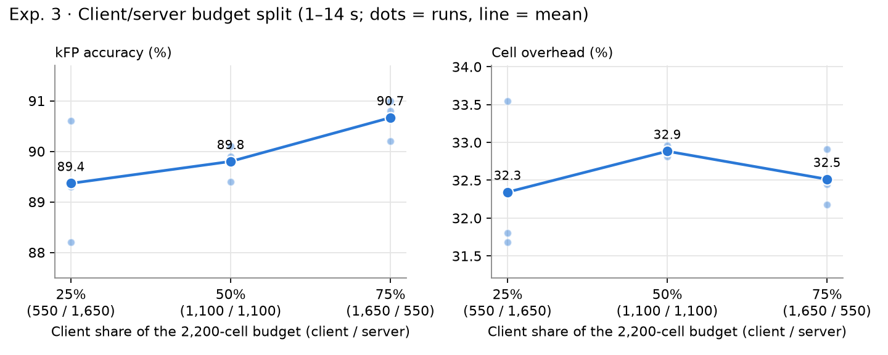
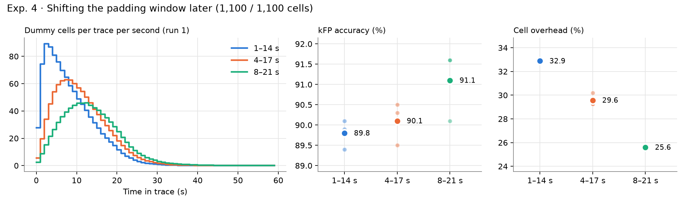

# Reah Robinson: FRONT experiments #3 and #4 (Team N03)

Research question: on our fixed set of Tor traces, how do FRONT's padding direction (client/server split) and padding timing affect kFP accuracy and cell overhead?

- Generated: 2026-11-24 18:15 by `reah_experiments.py`
- Code commit when run: `0da3610602bb0c3af83ff2a2df9dff822b68e205` (checkpoint evidence SHA: `0da3610602bb0c3af83ff2a2df9dff822b68e205`)
- Software: Python 3.12.6, numpy 2.5.4, pandas 3.1.1, scikit-learn 1.9.1, Darwin arm64
- Data: `data/checkpoint/cells/`, 1010 traces processed (10 sites × 100 visits + 10 unmonitored); closed-world kFP scores the 1000 monitored traces.
- Each FRONT setting was padded **3 time(s)** (new random padding each run). Tables show the mean, with the min–max range across runs in brackets.

## Reference (no defense)

kFP accuracy without FRONT: **98.5%** (1000 traces scored), 0% overhead.

## Experiment 3: client/server budget split

Total configured budget held at 2,200 dummy cells; timing 1–14 s; `start_padding_time = 0`.

| Client / server (configured) | Client share | Actual client dummies per trace | Actual server dummies per trace | Inserted ÷ configured max | Cell overhead % | kFP accuracy % |
|---|---|---|---|---|---|---|
| 550 / 1,650 | 25% | 259 | 757 | 46.2% | 32.3 (31.7–33.5) | 89.4 (88.2–90.6) |
| 1,100 / 1,100 | 50% | 518 | 515 | 47.0% | 32.9 (32.8–33.0) | 89.8 (89.4–90.1) |
| 1,650 / 550 | 75% | 772 | 249 | 46.4% | 32.5 (32.2–32.9) | 90.7 (90.2–91.0) |

The configured values are maximums: for each trace FRONT draws its dummy count uniformly between 1 and the limit (about half on average), then drops any dummy cell scheduled after the original trace ends. So the same configured total can produce different inserted counts, which is why actual counts are reported.

## Experiment 4: shifting the padding window later

Limits held at 1,100 / 1,100 cells; the window range stays 13 s wide while both bounds move later; `start_padding_time = 0`.

| Window (min_wnd–max_wnd) | Median dummy-cell time | Inserted ÷ configured max | Cell overhead % | kFP accuracy % |
|---|---|---|---|---|
| 1–14 s | 7.2 (7.0–7.3) s | 47.0% | 32.9 (32.8–33.0) | 89.8 (89.4–90.1) |
| 4–17 s | 10.1 (10.0–10.2) s | 42.2% | 29.6 (29.2–30.2) | 90.1 (89.5–90.5) |
| 8–21 s | 12.9 (12.9–13.0) s | 36.6% | 25.6 (25.4–25.7) | 91.1 (90.1–91.6) |

Compare with Eden's #2, where only the upper bound moves.

## Sanity checks

- All 1010 input traces were found, and FRONT wrote 1010 output traces in every run.
- Original (non-dummy) cell count was identical before and after FRONT in every run.
- Every condition was scored on the same held-out trace IDs as the undefended reference: **yes** (`splits_match` column).

## Method

1. Each condition is its own section in `defenses/front/config.ini` (`reah_*`), copied from `[checkpoint]` with only the listed values changed, and run with the team's unchanged FRONT simulator.
2. Overhead is measured on the raw FRONT output before normalisation: 100 × (+888 and −888 cells) ÷ original cells.
3. Directions are normalised to ±1 (as `utils/norm.py` does) so kFP can't see the dummy marker.
4. kFP is the team's feature code (`extract.py`) with `new_main.py`'s closed-world evaluation: random forest (1,000 trees) + 3 nearest neighbours, all 3 must agree; 10 stratified 90/10 splits, `random_state=0`. The forest is refit for every condition and run.

## Files

| File | What it is |
|---|---|
| `runs.csv` | One row per condition and padding run: parameters, counts, accuracy, overhead |
| `predictions/*.csv` | Held-out predictions with trace IDs for every run |
| `splits.csv` | Held-out trace IDs for each of the 10 folds |
| `timing/*.csv` | Dummy cells per second of trace time (run 1), used for the timing plot |
| `samples/` | Trace `0-0` before FRONT and after each condition (run 1); dummy cells are ±888 |
| `exp3_split.png`, `exp4_shift.png` | Plots for the slides |
| `../../reah_experiments.py` | The script that produced all of this |
