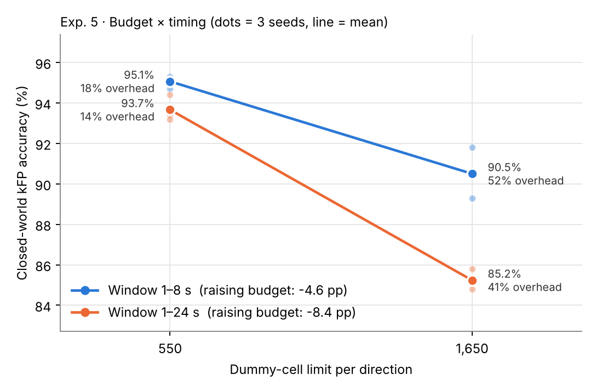
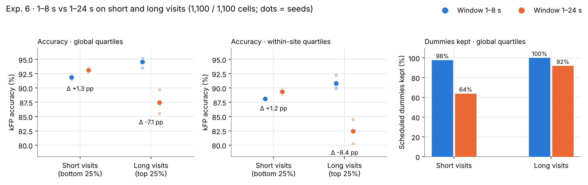

# Riya Ramakrishnan: FRONT experiments #5 and #6 (Team N03)

- Script: `riya_experiments.py` (runs) and `analyze.py` (tables, plots, tests). Run from anywhere:
  `python3 riya_experiments.py <repo root> results/riya` then `python3 analyze.py results/riya`.
- Method is Eden's `experiments/front-sweeps/run_front_sweeps.py` unchanged: team FRONT (`defenses/front/main.py`, `RP`),
  limit drawn uniformly from 1..N per direction, `min_wnd = 1`, `start_padding_time = 0`; seeds 301, 302, 303;
  kFP features from `attacks/kfingerprinting/extract.py`, closed-world evaluation from `new_main.py`
  (RF 1,000 trees, `n_jobs = 1`, 3 nearest neighbours must agree, 10 × StratifiedShuffleSplit 90/10, `random_state = 0`,
  `np.random.seed(1123)`).
- Only addition: per trace, the number of dummy cells FRONT **scheduled** and the number it **kept**
  (it drops any scheduled after the original trace ends). The logging wraps `getTimestamps` and uses no random numbers.
- Data: `data/checkpoint/cells/`, 1,010 traces processed, 1,000 monitored traces in kFP.
- Software: Python 3, numpy 2.5.3, pandas 3.0.5, scikit-learn 1.9.1, scipy 1.18.1, Linux x86_64, 2 cores.

## Reproduction check against Eden's #2

The six 1,100/1,100 runs (1–8 s and 1–24 s, seeds 301–303) were regenerated with the same procedure.
Dummy-cell counts match Eden's `runs.csv` exactly in all six. Accuracy matches in five; 1–24 s seed 302
is 90.1% here vs 90.2% in Eden's (one prediction, in the kFP step, likely platform/library differences).

## Experiment 5: budget × timing

| Limit per direction | Window | kFP accuracy % (min–max) | Cell overhead % | Client / server overhead % | Scheduled dummies kept |
|---|---|---|---|---|---|
| 550 | 1–8 s | 95.1 (94.7–95.3) | 17.5 | 71.0 / 9.9 | 99.2% |
| 550 | 1–24 s | 93.7 (93.2–94.4) | 13.5 | 54.8 / 7.7 | 76.4% |
| 1,650 | 1–8 s | 90.5 (89.3–91.8) | 52.3 | 212.0 / 29.7 | 99.3% |
| 1,650 | 1–24 s | 85.2 (84.8–85.8) | 40.6 | 165.8 / 22.9 | 77.1% |

Client/server overhead is dummies in that direction ÷ real cells in that direction (outgoing real cells are few, so client overhead is large).

**Raising the limit from 550 to 1,650:**

| Window | Accuracy change | Overhead change | Accuracy change per +10 pp overhead |
|---|---|---|---|
| 1–8 s | −4.6 pp (seeds: −4.9, −2.9, −5.9) | +34.8 pp | −1.3 pp |
| 1–24 s | −8.4 pp (seeds: −8.3, −8.4, −8.6) | +27.1 pp | −3.1 pp |

**Interaction** (change at 1–24 s minus change at 1–8 s): **−3.9 pp**. Seeds are not truly paired across settings,
so all 81 combinations of seed results were compared: range −6.7 to −1.4 pp, negative in every one.
A bigger budget helps more when the window is wider, even though the wider window adds less overhead.
1,650 at 1–24 s gives the lowest accuracy of any setting the team has run (85.2%) at 40.6% overhead,
below Eden's 1,650 at 1–14 s (86.1% at 49.1%).

## Experiment 6: timing sensitivity on short vs long visits

Groups are defined from original (undefended) trace duration over the 1,000 monitored visits, before any predictions
were read (`exp6_groups.csv`): short ≤ 20.1 s (bottom quartile), long ≥ 28.8 s (top quartile).
Comparisons pair the same (fold, visit) predictions across 1–8 s and 1–24 s for each seed.

| Grouping | Group | Visits / tested / predictions | Acc 1–8 s | Acc 1–24 s | Change (seed range) | Overhead 1–8 → 1–24 s | Dummies kept 1–8 → 1–24 s | Correct→wrong / wrong→correct (3 seeds) |
|---|---|---|---|---|---|---|---|---|
| Global quartiles | Short | 250 / 155 / 233 | 91.8 | 93.1 | **+1.3** (+0.9 to +1.7) | 58.9 → 38.4% | 97.7 → 63.8% | 20 / 29 |
| Global quartiles | Long | 250 / 176 / 263 | 94.5 | 87.5 | **−7.1** (−8.0 to −5.3) | 25.8 → 23.7% | 100.0 → 91.8% | 62 / 6 |
| Within-site quartiles | Short | 250 / 155 / 216 | 88.1 | 89.4 | **+1.2** (+0.9 to +1.4) | 38.4 → 26.4% | 98.5 → 67.8% | 23 / 31 |
| Within-site quartiles | Long | 250 / 173 / 258 | 90.8 | 82.4 | **−8.4** (−9.7 to −7.8) | 31.2 → 27.2% | 99.8 → 87.2% | 73 / 8 |

Full set (Eden's #2 numbers): 92.7% → 88.9% accuracy, 35.0% → 27.4% overhead, 99.3% → 77.8% dummies kept.

McNemar (exact, per seed, `exp6_by_seed.csv`): long visits p ≤ 0.001 in every seed under both groupings;
short visits p = 0.42–0.82 in every seed (no significant change).

**Reading:** the whole accuracy drop from widening the window comes from long visits. On short visits 1–24 s throws away
about a third of the scheduled dummies (they're timed after the page finishes), overhead falls, and the defense gets
no stronger (slightly weaker, not significant). Long visits keep most of their dummies and the attack loses 7–8 pp.
This supports the discard explanation for #2.

**Site composition:** global quartiles are dominated by a few sites (site 4 supplies 96 of 250 short visits; sites 1–3 and 9
supply most long ones, `exp6_site_composition.csv`). The within-site version (bottom/top 25 visits of each site) gives
the same result, so the effect is about visit length, not which sites are in each group.

## Note on the evaluation (affects every team experiment)

`StratifiedShuffleSplit(n_splits=10, test_size=0.1)` draws 10 independent test sets; it does not partition the data.
The "1,000 scored" are 1,000 predictions covering 663 distinct visits: 337 are never tested and some are tested up to
6 times. Every condition uses the same draws, so comparisons between settings are fair, but write-ups should say
"1,000 held-out predictions" rather than "1,000 traces". `StratifiedKFold(n_splits=10)` would test each visit once.

## Files

| File | What it is |
|---|---|
| `runs.csv` | One row per setting and seed: accuracy, overhead (total, client, server), dummies scheduled and kept |
| `predictions-N*-W*-seed*.csv` | Held-out predictions (fold, visit, true site, 3 neighbours, correct) |
| `trace-stats-N*-W*-seed*.csv` | Per trace: duration, real cells per direction, dummies scheduled and kept per direction |
| `exp5_summary.csv` | #5 mean / min / max per setting |
| `exp6_groups.csv`, `exp6_site_composition.csv` | #6 group membership and site counts |
| `exp6_by_seed.csv`, `exp6_summary.csv` | #6 subgroup results per seed and averaged, with McNemar counts and p-values |
| `results.json` | Headline numbers used in this README |
| `exp5_budget_timing.png`, `exp6_short_long.png` | Plots for the slides |
